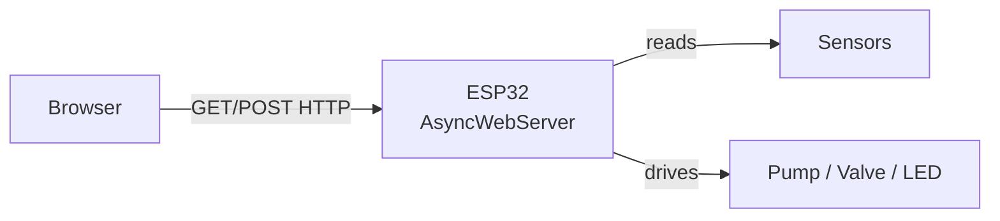
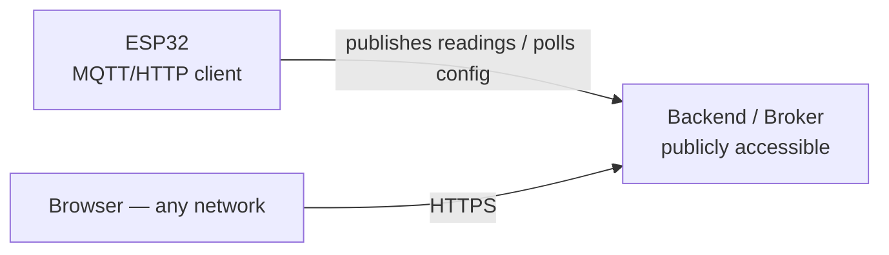

# Architecture

## Context

The gateway needs to do two things: expose actuator control (LED today, pump/valve later) and report sensor readings, accessible to a client (browser). Two architectures were considered.

## Architecture A — ESP32 as server (in use)

The ESP32 runs an `AsyncWebServer` and serves both the HTML page and the REST API (`/led`, `/api/status`). The client talks directly to the ESP32.

**Advantages**: simple, no extra infrastructure, minimal latency.
**Limitations**:
- Only reachable inside the local network, unless additional router configuration is added (port forwarding, VPN or reverse tunnel) — see ADR 0001.
- Requires the WiFi radio to always be on waiting for a connection — not viable for battery operation with deep sleep.

Adequate for the current scenario: gateway powered from an outlet, used within the same WiFi network.

## Architecture B — ESP32 as a client of a broker/backend (planned)

The ESP32 stops listening for connections — it initiates communication itself (`push`), publishing readings and polling for configuration periodically, then goes back to sleep between cycles. The backend (an MQTT broker + a small application, or a service like Adafruit IO) is publicly accessible and is what serves the web interface to the client.

**Advantages**:
- Trivial remote access (the backend is already meant to be public; no network configuration needed on the ESP32 side).
- Compatible with deep sleep — the ESP32 only needs the radio on during the publish cycle.

**Cost**: requires an additional, always-on infrastructure component (a hosted backend, whether in the cloud or on a device like a Raspberry Pi).

## Decision

Keep Architecture A for the current development phase (firmware/hardware validation on the local network). Migrating to Architecture B becomes necessary as soon as either of two already-identified requirements shows up: access from outside the local network, and/or battery operation. See [ADR 0001](decisions/0001-server-vs-broker-architecture.md).
